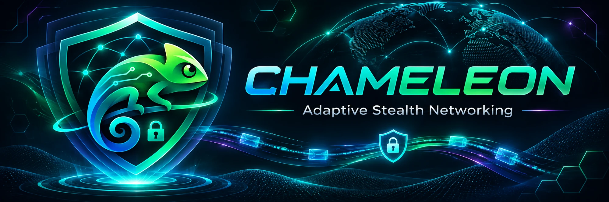
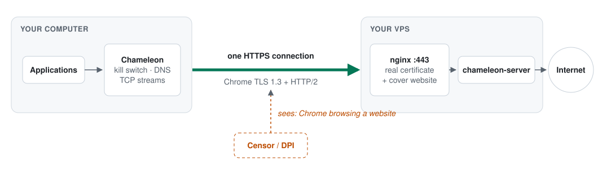

<p align="center">
  
</p>

<p align="center">
  
  
  
  
  
</p>

<h3 align="center">Your own private tunnel that looks like an ordinary website.</h3>

<p align="center">
  Chameleon sends all internet traffic of your computer through <b>your own server</b>,<br>
  inside a connection that to a filtering system looks like Chrome browsing one HTTPS website.
</p>

---

## Contents

- [Why Chameleon](#why-chameleon)
- [Features](#features)
- [How it works](#how-it-works)
- [Quick start](#quick-start)
- [Everyday use](#everyday-use)
- [Security and privacy](#security-and-privacy)
- [Requirements](#requirements)
- [Choosing a server](#choosing-a-server)
- [Troubleshooting](#troubleshooting)
- [Building from source](#building-from-source)
- [Repository layout](#repository-layout)
- [Documentation](#documentation)
- [License](#license)

## Why Chameleon

Ordinary VPN protocols are easy to recognise: their handshakes, packet sizes and
timing give them away, and censorship systems block them in minutes. Chameleon
takes the opposite approach — **it does not try to hide that it is encrypted
traffic; it makes that traffic look like a browser talking to a normal website**:

- a real TLS 1.3 connection with a **Chrome fingerprint**, to a real **nginx**
  server with a **Let's Encrypt** certificate;
- a real cover website: anyone who opens your server in a browser or scans it
  sees a website, and the tunnel path answers outsiders with nginx's own 404;
- traffic that keeps the shape of browsing: HTTP/2 flow control like Chromium,
  full-size TLS records, no artificial keep-alive chatter.

You own the whole path: the client on your computer and the server on a VPS you
rent. There is no third-party service in between.

## Features

| | |
|---|---|
| 🦎 **Looks like a browser** | uTLS Chrome 157 profile (matches real Chrome by JA4), HTTP/2 settings and window like Chromium, masked TLS-in-TLS handshakes, randomised connection openings |
| 🌐 **Whole computer through the tunnel** | every application, not just the browser — on Windows and on Linux |
| 🛡️ **Kill switch** | nothing leaves directly while the tunnel starts, fails, the program crashes, or the computer reboots — until you press **Disable** |
| 🔒 **DNS only through the tunnel** | every DNS query, whatever server it targets, is answered through the tunnel; your provider never sees a lookup |
| 🚫 **IPv6 closed** | the tunnel carries IPv4; IPv6 is blocked completely while Chameleon is on, so it can never bypass the tunnel |
| ⚡ **Fast** | every TCP connection travels as its own stream — no TCP-inside-TCP slowdowns; 150+ Mbit/s measured |
| 🖥️ **Simple panel** | a web panel opens by itself: create a password, enter your server, press **Deploy & Start**, then **Enable** |
| 🏠 **Local network stays local** | the router, printers and the panel stay reachable over IPv4; the panel is never reachable from the internet |
| 🧰 **One-click server setup** | the panel installs and maintains the server over SSH: nginx, certificate, cover site, tunnel |
| 📦 **One file to start** | unpack the package and start `start_chameleon.bat` — double-click on Windows, **Run as a Program** on Linux; the same file on both |

## How it works

<picture>
  <source media="(prefers-color-scheme: dark)" srcset="docs/images/how-it-works-dark.svg">
  
</picture>

1. Applications on your computer use the network as usual.
2. Chameleon takes every connection: TCP connections become separate streams,
   everything else (DNS, UDP) travels as encrypted packets.
3. All of it leaves inside **one long HTTPS connection** to your server, with a
   second, end-to-end encryption layer (XChaCha20-Poly1305) inside the TLS.
4. On the server nginx terminates TLS like for any website and hands the tunnel
   path to `chameleon-server`, which opens the connections to the internet.

The full protocol is described in [docs/ARCHITECTURE.md](docs/ARCHITECTURE.md).

## Quick start

You need a VPS (see [Requirements](#requirements)) and the release package for
your computer.

Before extracting a release or running its installer, verify the archive with
the [release signature instructions](docs/RELEASE_SIGNING.md#verify-before-installation).

### 1. Install on Windows

1. Download `chameleon-windows-1.2.1.zip` and unpack it.
2. Double-click **`start_chameleon.bat`**.
3. Windows asks once for administrator rights — choose **Yes**.
   Chameleon installs itself as two Windows services.
4. The panel opens in your browser at **https://localhost:8443**. It uses its
   own certificate. Follow the [certificate checks](docs/PANEL.md#verify-the-panel-certificate)
   before accepting it or entering credentials.

> Chameleon is not signed with a paid code-signing certificate, so Windows
> SmartScreen may show *“Windows protected your PC”* the first time. Choose
> *More info → Run anyway*.

### 1. Install on Linux (Debian / Ubuntu)

1. Download `chameleon-panel-1.2.1.tar.gz`, right-click it and choose
   **Extract** (or **Extract Here**). A folder `chameleon-panel-1.2.1` appears.
2. Open that folder and start **`start_chameleon.bat`** in either way:
   - **From the file manager:** right-click `start_chameleon.bat` →
     **Run as a Program**.
   - **From a terminal:** right-click an empty spot inside the folder →
     **Open in Terminal**, then type `./start_chameleon.bat` and press Enter.
3. A terminal window shows the installation. When asked, enter the password of
   your account on this computer. The window stays open until you press any key.
4. The panel opens in your browser at **https://localhost:8443**.

> The command `./start_chameleon.bat` works only in a terminal opened **inside
> the unpacked folder** — that is why the terminal is opened with
> **Open in Terminal** from that folder. In a terminal opened elsewhere, first go
> into the folder, for example `cd ~/Downloads/chameleon-panel-1.2.1`.

Without a desktop (a server over SSH), run these commands in the folder that
holds the downloaded archive:

```sh
tar -xzf chameleon-panel-1.2.1.tar.gz
cd chameleon-panel-1.2.1
./start_chameleon.bat        # or: sudo ./install.sh
```

`start_chameleon.bat` opens the panel in the browser when there is a desktop.
The installer shows progress and prints `https://localhost:8443` first for
use on the same computer. It also prints a one-time
**setup code** for creating the password from another device — handy on a
machine without a desktop.
Verify the panel certificate before entering a password or setup code from
another device. [Certificate checks](docs/PANEL.md#verify-the-panel-certificate).

### 2. Create your password

On the same computer the panel lets you create the password right away. From
another device in your network you enter the setup code first.

### 3. Set up your server

In the panel:

1. **Client** tab — generate the **PSK** and the **public marker**, enter your
   VPS address, press **Save client**.
2. **Server** tab — enter the VPS **Host / IP**, **Login**, **Port** and
   **Password**, press **Check SSH**.
3. Compare the shown host-key fingerprint with the one from your VPS provider;
   only if they match, press **Trust host key**.
4. Accept the Let's Encrypt Subscriber Agreement and press **Deploy & Start**.
   A fresh server takes 5–10 minutes; the log shows when it is done.
5. Optional: point a domain to the VPS and use **Configure Domain & TLS** for an
   even more website-like identity.

### 4. Turn it on

Press **Enable** (top right). The status turns to **Chameleon active** and your
public IP becomes your server's address.

## Everyday use

| I want to… | Do this |
|---|---|
| open the panel | start `start_chameleon.bat` again (Windows: double-click; Linux: right-click → **Run as a Program**), or open https://localhost:8443 |
| turn the tunnel on / off | **Enable** / **Disable** in the panel |
| see what is going on | the status line, the **Profile** tab and its runtime log |
| get the internet back without the panel — Windows | `"C:\Program Files\Chameleon\chameleon-svc.exe" recover` in PowerShell as administrator |
| get the internet back without the panel — Linux | `sudo chameleon-panel disable` |
| reset a forgotten password | **Forgot password? Reset** on the sign-in page of the same computer; on a server without a desktop `sudo chameleon-panel reset-password` |
| update | unpack the new package and run its `start_chameleon.bat`; settings and keys are kept |
| remove — Windows | `"C:\Program Files\Chameleon\chameleon-svc.exe" uninstall` in PowerShell as administrator (add `--purge` to delete settings and keys) |
| remove — Linux | in the unpacked package folder: **Open in Terminal**, then `sudo ./uninstall.sh` (add `--purge` to delete settings and keys) |

Chameleon starts with the computer. If it was enabled, the kill switch is back
before the network comes up and the tunnel reconnects on its own.

## Security and privacy

- **Two layers of encryption.** TLS 1.3 to nginx, and inside it Chameleon's own
  end-to-end XChaCha20-Poly1305 with per-session keys, replay protection and
  per-stream keys. nginx on your server only ever sees encrypted request bodies.
- **Fail-closed.** With Chameleon enabled your computer never talks to the
  internet directly: not while connecting, not after a failure, a crash or a
  reboot. Verified on Windows by stopping and killing the service.
- **No leaks.** DNS goes only through the tunnel, QUIC is blocked so browsers use
  TCP, IPv6 is closed completely (verified on a real IPv6 mobile network,
  including NAT64 and the computer's own IPv6 address).
- **The panel is local.** HTTPS with its own certificate, reachable only from
  this computer and the local network (enforced twice: by a firewall rule and by
  the panel itself). Password hashed with scrypt, rate-limited sign-in, CSRF
  protection, sessions that end when the password changes.
- **Least privilege.** The panel runs without administrator rights; the only
  privileged actions go through one narrow command (Linux) or one access-
  controlled pipe (Windows).
- **Credentials at rest.** The VPS SSH password or key is encrypted with
  `systemd-creds` (TPM when available) on Linux and DPAPI on Windows.
- **Your server is yours.** The server sees which websites the tunnel reaches —
  like any VPN server. Choose a provider and a country you trust.

## Requirements

| | |
|---|---|
| **Windows client** | Windows 10 or 11, 64-bit (x64); administrator rights once, for installation |
| **Linux client** | Debian or Ubuntu with systemd, x86-64 or ARM64 |
| **Server (VPS)** | Ubuntu or Debian, x86-64, public IPv4 address, root SSH access (password or key), ports 80 and 443 free; 1 vCPU and 1 GB RAM are enough for one household |
| **Optional** | a domain name pointing to the VPS (otherwise a certificate for the IP address is used) |

## Choosing a server

The tunnel can only be as good as the route between you and your VPS. Before you
buy, check two things:

1. **The country and provider.** A server in a country that filters the internet
   inherits that filtering: sites blocked there stay blocked through the tunnel.
2. **The route to your networks.** Some providers reach some networks over
   congested links. For example, a VPS whose traffic enters Deutsche Telekom
   through Cogent lost 40–70% of its packets towards Telekom mobile customers —
   with or without Chameleon — while the same VPS was fast on other networks.
   From the VPS, run `mtr -r -c 50 <your home or mobile IP>` and make sure there
   is no loss from the hop where your provider's network starts.

## Troubleshooting

<details>
<summary><b>The tunnel connects, but nothing loads (often on mobile data)</b></summary>

This is almost always the route between the VPS and your network (see
[Choosing a server](#choosing-a-server)). Test the same network without
Chameleon: download a file from the VPS over SSH. If it is slow there too, the
cause is the route, not Chameleon — use a VPS with a better route to that network.
</details>

<details>
<summary><b>Some websites do not open through the tunnel</b></summary>

The VPS cannot reach them itself — they are blocked in the server's country or by
its provider. Choose a server in another country.
</details>

<details>
<summary><b>No internet after a crash, and the panel does not open</b></summary>

The kill switch is doing its job. Get the internet back with
`chameleon-svc.exe recover` (Windows, as administrator) or `sudo chameleon-panel disable`
(Linux).
</details>

<details>
<summary><b>The status says the server is unavailable</b></summary>

Open **Server → Check SSH**. If the VPS was reinstalled or Chameleon was removed
from it, run **Deploy & Start** again.
</details>

<details>
<summary><b>Things on my local network stopped working while Chameleon is on</b></summary>

Devices that work only over IPv6 are blocked by design while Chameleon is
enabled. Everything reachable over IPv4 — the router, printers, NAS — keeps
working.
</details>

## Building from source

Requirements: **Go 1.27.4** (downloaded and checked automatically by
`ensure-go.sh` when missing), **Node.js** with npm for the web panel, **Python 3**
with pip for the Windows package.

```sh
./build.sh                  # Linux binaries: server, clients (amd64 + arm64)
panel/build-release.sh      # Linux package   -> dist/chameleon-panel-<version>.tar.gz  (on Linux)
panel/build-windows.sh      # Windows package -> dist/chameleon-windows-<version>.zip   (Git Bash or Linux)
```

Tests:

```sh
go test ./...
python -m pytest panel/backend/tests
cd panel/frontend && npx tsc --noEmit
```

The version comes from one place: the `VERSION` file.

## Repository layout

```
clientcore/            client core: transport, session, epochs, streams, fingerprint
server/                chameleon-server, cover website, nginx patch and tool
shared/                cryptography, formats, stream frames, record shaping
tcprelay/              TCP stream relay shared by the Linux and Windows clients
cmd/chameleon-client/  Linux client
cmd/chameleon-windows/ Windows client, services and WFP kill switch
panel/                 the Chameleon Panel: backend, web UI, Linux installer
tools/                 test stands and measurements
docs/                  architecture, panel and measurement reports
start_chameleon.bat    launcher for Windows and Linux (shipped inside the packages)
```

## Documentation

| | |
|---|---|
| [docs/ARCHITECTURE.md](docs/ARCHITECTURE.md) | protocol, carrier, TCP streams, masking, clients, server, measurements |
| [docs/PANEL.md](docs/PANEL.md) | the panel: access, password, security model |
| [docs/RELEASE_SIGNING.md](docs/RELEASE_SIGNING.md) | release signing and verification with Ed25519 |
| [CHANGELOG.md](CHANGELOG.md) | what changed in each version |
| [docs/](docs/) | Chrome comparison, load test, transport and shape measurements |
| [NOTICE](NOTICE) | what the license covers and what it does not |
| [THIRD_PARTY_NOTICES.md](THIRD_PARTY_NOTICES.md) | third-party components and their licenses |

## License

Chameleon's own source code is licensed under the
**[Mozilla Public License 2.0](LICENSE)** (MPL-2.0).
Copyright © 2026 NewNetGuard.

- **Exceptions** are listed in [NOTICE](NOTICE): the kill-switch files adapted
  from WireGuard for Windows stay under MIT, and the nginx context in the server
  patch stays under nginx's BSD-2-Clause license.
- **The banner and the icon** (`banner.webp`, `chameleon.png`, `favicon.png`)
  were made with the ChatGPT image generator and are **not** licensed under
  MPL-2.0; they may be redistributed unmodified as part of Chameleon — see
  [NOTICE](NOTICE).
- **The names** "Chameleon" and "EasyPi" are not licensed (MPL-2.0 §2.3).
- **Third-party components** keep their own licenses; see
  [THIRD_PARTY_NOTICES.md](THIRD_PARTY_NOTICES.md). Every release package
  carries `LICENSE`, `NOTICE`, `THIRD_PARTY_LICENSES.txt` and `SOURCE.txt` — the
  address of the source code of exactly that version.

Chameleon is provided as is, without warranty. Users are responsible for
their own actions when using it. See [NOTICE](NOTICE) and sections 6 and 7
of the [MPL 2.0 license](LICENSE) for the warranty disclaimer and limits
of liability.
